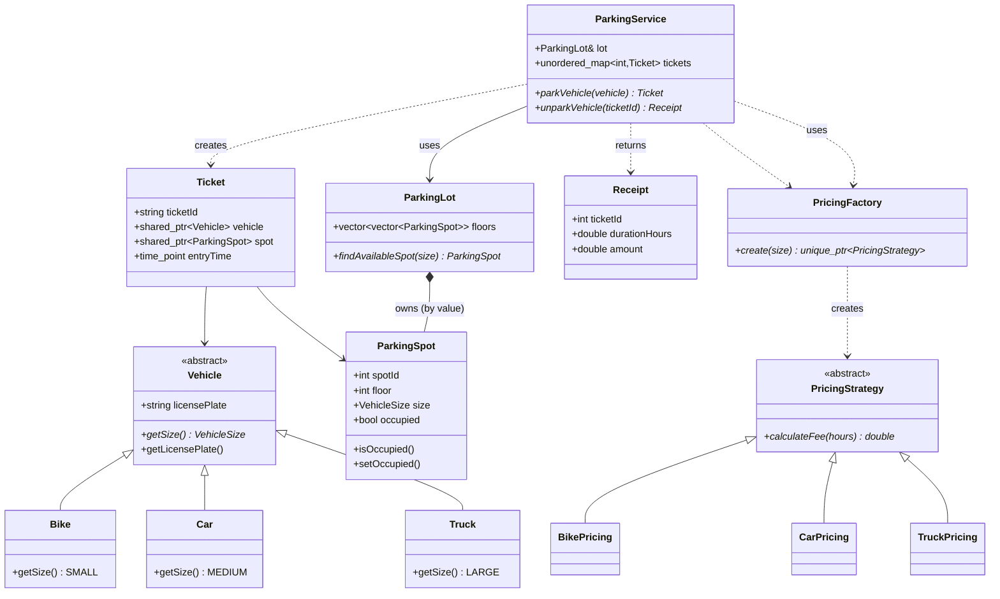

# Parking Lot Management System (C++17 / CMake)

## Problem Statement

Design and implement an in-memory parking lot management system that can:

- Model different vehicle types by the size of spot they need (bike, car, truck).
- Manage multiple floors of fixed-size parking spots.
- Park vehicles in the nearest suitable free spot (lowest floor first).
- Issue tickets on entry and compute time-based fees on exit.
- Handle full-lot and invalid-ticket errors cleanly via exceptions.
- Expose the whole workflow through a simple console menu (no persistence yet).

## Features

- **Vehicles:** abstract `Vehicle` (`licensePlate`, pure virtual `getSize()`), concrete `Bike` (SMALL), `Car` (MEDIUM), `Truck` (LARGE).
- **Spots & lot:** `ParkingSpot` (`spotId`, `floor`, `VehicleSize`, occupied flag); `ParkingLot` owns a `vector<vector<ParkingSpot>>` (one vector per floor), split ~1/3 SMALL / ~1/3 MEDIUM / rest LARGE per floor, with `findAvailableSpot()` scanning lowest floor first.
- **Ticketing:** `Ticket` (`ticketId`, `shared_ptr<Vehicle>`, `shared_ptr<ParkingSpot>`, `chrono::system_clock::time_point entryTime`).
- **Service layer:** `ParkingService::parkVehicle()` (find spot → occupy → timestamp → store in `unordered_map<int, Ticket>` → return copy) and `unparkVehicle(int)` (validate → duration → price → free spot → erase → return `Receipt{durationHours, amount}`).
- **Pricing (Strategy pattern):** `PricingStrategy::calculateFee(hours)` with `BikePricing` (₹20/hr, ₹200/day cap), `CarPricing` (₹50/hr, ₹500/day cap), `TruckPricing` (₹100/hr, ₹1000/day cap); `PricingFactory::create(VehicleSize)` returns the right `unique_ptr<PricingStrategy>`. Fee = `min(rate × hours, dailyCap × ceil(hours/24))`.
- **Errors:** `LotFullException` (no matching free spot), `InvalidTicketException` (unknown or already-used ticket) — both derive from `std::runtime_error`.
- **Console UI (`main.cpp`):** loop with Park / Unpark / View available spots / Exit, formatted output, exceptions printed as `Lot is full: ...` / `Invalid ticket: ...`.

## Project Layout

```
parking-lot-system/
├── CMakeLists.txt        # C++17, globs src/*.cpp
├── main.cpp              # console menu loop
├── include/
│   ├── Vehicle.h         # VehicleSize enum + abstract Vehicle
│   ├── Bike.h / Car.h / Truck.h
│   ├── ParkingSpot.h
│   ├── ParkingLot.h
│   ├── Ticket.h
│   ├── Receipt.h         # { ticketId, durationHours, amount }
│   ├── LotFullException.h / InvalidTicketException.h
│   ├── ParkingService.h
│   ├── PricingStrategy.h
│   ├── BikePricing.h / CarPricing.h / TruckPricing.h
│   └── PricingFactory.h
└── src/                  # one .cpp per class above
```

## Class Diagram



## Design Patterns & Lifetime Management

### Strategy for pricing (why)

Parking fees vary by vehicle size but the checkout flow (`unparkVehicle`) should not change when rates change. The Strategy pattern solves this:

- `PricingStrategy` defines the interface; each concrete class encapsulates one rate table + cap.
- `PricingFactory` centralizes the size → strategy mapping, so `ParkingService` just calls `create(size)->calculateFee(hours)`.
- Adding a new vehicle class or a surge/night pricing variant means adding one class + one factory branch — no changes to `ParkingService`, `Ticket`, or the menu (Open/Closed Principle).

### Smart pointers

- `shared_ptr<Vehicle>` — ownership is shared between the caller (menu) and the stored `Ticket`, so the vehicle stays alive while parked even if the caller drops its copy. Copying a `Ticket` out of the map is safe.
- `shared_ptr<ParkingSpot>` inside `Ticket` — spots are **owned by value** in `ParkingLot::floors`, so the ticket holds a **non-owning** `shared_ptr` (constructed with a no-op deleter) purely as a safe reference. Freeing a spot is just `setOccupied(false)`; no heap ownership transfers.
- `unique_ptr<PricingStrategy>` — the factory hands exclusive ownership to the caller (`unparkVehicle`), which uses it once and lets it die at scope end. No leaks, no shared state, and the polymorphic type is preserved through the base-class pointer.

## Build & Run (CMake)

Prerequisites: CMake ≥ 3.10 and a C++17 compiler (Clang/GCC/MSVC).

```bash
cd parking-lot-system
cmake -S . -B build
cmake --build build
./build/parking-lot-system
```

Sample session:

```
=== Parking Lot Menu ===
1. Park a vehicle
2. Unpark a vehicle
3. View available spots
4. Exit
Enter choice: 1
Vehicle type (1=Bike, 2=Car, 3=Truck): 1
License plate: BIKE-001
Parked. Ticket ID: 1, Spot: 0 (Floor 0)
...
Enter choice: 3
Available spots:
  Floor 0: 2 SMALL, 3 MEDIUM, 3 LARGE free (8 total)
  Floor 1: 3 SMALL, 3 MEDIUM, 3 LARGE free (9 total)
Enter choice: 2
Ticket ID: 1
Unparked. Ticket 1, Duration: 0.01 hrs, Amount: Rs.0.20
```

The demo lot is `ParkingLot(2, 9)` (2 floors × 9 spots); edit `main.cpp` to resize.

## Future Extensions

- **Multiple lots:** introduce a `ParkingLotManager` holding named lots, route `parkVehicle` by location/preference, aggregate availability.
- **Persistence:** serialize tickets, spots, and receipts (SQLite/file-backed store) so state survives restarts; add a repository interface to keep `ParkingService` testable.
- **Reservation system:** hold spots with expiry timestamps, a waitlist per size, and notifications; requires time-based eviction of stale holds.
- **Multi-threading for concurrent entries:** guard `findAvailableSpot` + occupy and the ticket map with per-floor mutexes (or a lot-wide lock to start), use atomic ticket IDs, and stress-test park/unpark races at multiple gates.
